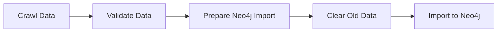
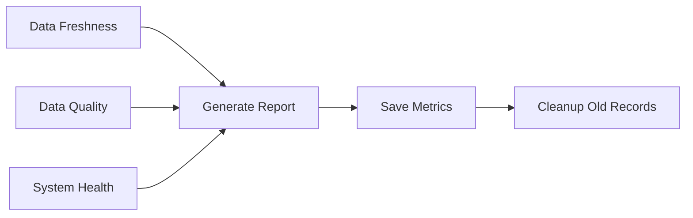

# LapGenie - Enhanced Laptop Data Pipeline with Airflow & Neo4j

LapGenie là một pipeline xử lý dữ liệu laptop hoàn chỉnh và mạnh mẽ sử dụng Apache Airflow để quản lý workflow và Neo4j để lưu trữ dữ liệu dạng graph. Phiên bản nâng cấp bao gồm data validation, monitoring, error recovery và data quality tracking.

## 🚀 **Tính năng mới trong phiên bản 2.0**

### ✨ **Data Pipeline Enhancements**
- **Complete Neo4j Integration**: Pipeline hoàn chỉnh từ crawling đến import vào Neo4j
- **Data Validation**: Kiểm tra chất lượng dữ liệu trước khi import
- **Error Recovery**: Khả năng resume crawling từ breakpoint
- **Progress Tracking**: Lưu tiến độ crawling định kỳ

### 📊 **Monitoring & Quality**
- **Data Quality Metrics**: Theo dõi completeness, accuracy, freshness
- **System Health Monitoring**: Kiểm tra trạng thái Neo4j, indexes, constraints
- **Automated Alerting**: Cảnh báo khi quality hoặc system có vấn đề
- **Historical Tracking**: Lưu trữ metrics theo thời gian

### 🔧 **Technical Improvements**
- **Enhanced Error Handling**: Retry logic, graceful failures
- **Better Data Extraction**: Improved parsing với multiple selectors
- **Brand Recognition**: Tự động nhận diện thương hiệu từ tên sản phẩm
- **Relationship Mapping**: Tạo relationships đầy đủ trong Neo4j graph

## 🏗️ Cấu trúc Project

```
LapGenie/
├── docker-compose.yaml          # Cấu hình Docker services
├── src/
│   ├── neo4j/
│   │   └── init/
│   │       └── init.cypher      # Enhanced Neo4j schema với relationships
│   └── airflow/
│       ├── dags/                # Airflow DAGs
│       │   ├── update_db_dag.py # Main crawling pipeline với validation
│       │   └── monitoring_dag.py # Monitoring và quality checks
│       ├── config/              # Cấu hình Airflow
│       ├── logs/                # Logs Airflow
│       └── plugins/             # Plugins Airflow
├── data/                        # Dữ liệu crawl
├── requirements.txt             # Python dependencies
├── .env-example                 # Mẫu file environment
├── clean-and-restart.sh         # Script dọn dẹp và khởi động lại
└── check-services.sh            # Script kiểm tra trạng thái services
```

## 🚀 Cách sử dụng

### 1. Chuẩn bị môi trường

Tạo file `.env` từ `.env-example`:

```bash
# Trên Linux/WSL
cp .env-example .env

# Trên Windows
copy .env-example .env
```

### 2. Khởi động services

```bash
# Dọn dẹp và khởi động lại (khuyến nghị)
./clean-and-restart.sh

# Hoặc khởi động bình thường
docker-compose up -d
```

### 3. Kiểm tra trạng thái

```bash
# Kiểm tra status các services
./check-services.sh

# Xem logs
docker-compose logs -f

# Xem logs của service cụ thể
docker-compose logs -f neo4j
docker-compose logs -f airflow-apiserver
```

## 🌐 Truy cập ứng dụng

- **Airflow Web UI**: http://localhost:8080
  - Username: `airflow`
  - Password: `airflow`

- **Neo4j Browser**: http://localhost:7474
  - Username: `neo4j`
  - Password: `neo4j_password`

- **Flower** (nếu enable): http://localhost:5555

## 🔄 **Data Pipeline Workflow**

### Main Pipeline (update_database_dag)


1. **Crawl Laptop Data**: Web scraping với retry logic và progress saving
2. **Validate Data**: Kiểm tra data quality và completeness
3. **Prepare Import**: Tạo Cypher queries cho Neo4j import
4. **Clear Old Data**: Dọn dữ liệu cũ (> 30 ngày)
5. **Import to Neo4j**: Import products, brands, price ranges, relationships

### Monitoring Pipeline (monitoring_dag)


- **Schedule**: Chạy mỗi 6 giờ
- **Checks**: Freshness, quality scores, system health
- **Alerting**: Automatic alerts khi có issues
- **History**: Lưu metrics để trending

## 🛠️ Services

### 1. PostgreSQL
- Port: 5432 (internal)
- Database: airflow
- Username: airflow
- Password: airflow

### 2. Redis
- Port: 6379 (internal)
- Sử dụng làm message broker cho Celery

### 3. Neo4j (Enhanced)
- HTTP Port: 7474
- Bolt Port: 7687
- Username: neo4j
- Password: neo4j_password
- Plugins: APOC
- **New**: Comprehensive schema với constraints, indexes, relationships

### 4. Airflow Services
- **API Server**: Port 8080
- **Scheduler**: Quản lý DAGs
- **Worker**: Thực thi tasks
- **Triggerer**: Xử lý deferred tasks

## 📊 **Data Quality Metrics**

### Quality Scoring
- **Name Completeness**: 30% weight
- **Price Completeness**: 30% weight  
- **Description Quality**: 20% weight
- **Brand Relationships**: 20% weight

### Monitoring Thresholds
- **Minimum Quality Score**: 80%
- **Data Freshness**: 7 days
- **Alert Levels**: WARNING, CRITICAL

## 🗃️ **Neo4j Graph Schema**

### Nodes
- **Product**: Laptop products với full metadata
- **Brand**: Thương hiệu với country, founded year
- **PriceRange**: Phân khúc giá với boundaries
- **SpecCategory**: Categories for specifications
- **MonitoringReport**: Historical quality metrics

### Relationships
- `(Product)-[:BELONGS_TO]->(Brand)`
- `(Product)-[:IN_RANGE]->(PriceRange)`
- `(Product)-[:HAS_SPEC]->(Specification)`
- `(Specification)-[:BELONGS_TO_CATEGORY]->(SpecCategory)`

### Example Queries
```cypher
// Find gaming laptops under 20M
MATCH (p:Product)-[:IN_RANGE]->(pr:PriceRange)
WHERE pr.max_price <= 20000000 
  AND p.name CONTAINS "gaming"
RETURN p, pr

// Brand analysis
MATCH (b:Brand)<-[:BELONGS_TO]-(p:Product)
RETURN b.name, count(p) as product_count, 
       avg(p.price) as avg_price
ORDER BY product_count DESC

// Quality trend analysis
MATCH (m:MonitoringReport)
WHERE m.timestamp > datetime() - duration('P7D')
RETURN m.timestamp, m.quality_score, m.total_products
ORDER BY m.timestamp
```

## 🐛 Troubleshooting

### Neo4j không khởi động được

```bash
# 1. Dọn dẹp volumes và restart
./clean-and-restart.sh

# 2. Kiểm tra logs
docker-compose logs neo4j

# 3. Kiểm tra initialization
docker-compose logs neo4j-init

# 4. Khởi động lại chỉ Neo4j
docker-compose restart neo4j
```

### Airflow DAG errors

```bash
# Check DAG logs
docker-compose logs airflow-scheduler

# Access Airflow logs directory
docker-compose exec airflow-worker ls -la /opt/airflow/logs/

# Test Neo4j connection từ Airflow
docker-compose exec airflow-worker python -c "
from airflow.providers.neo4j.hooks.neo4j import Neo4jHook
hook = Neo4jHook(conn_id='neo4j_default')
print('Connection test:', hook.test_connection())
"
```

### Data Quality Issues

```bash
# Check monitoring report
# Vào Airflow UI -> monitoring_dag -> latest run -> generate_monitoring_report

# Manual quality check
docker-compose exec neo4j cypher-shell -u neo4j -p neo4j_password -d neo4j "
MATCH (p:Product) 
RETURN count(p) as total,
       count(CASE WHEN p.price > 0 THEN 1 END) as with_price,
       count(CASE WHEN p.name IS NOT NULL THEN 1 END) as with_name
"
```

## 📈 **Performance Optimization**

### Neo4j Tuning
```bash
# Increase memory for large datasets
# In docker-compose.yaml:
NEO4J_server_memory_heap_initial__size: 1G
NEO4J_server_memory_heap_max__size: 2G
NEO4J_server_memory_pagecache_size: 1G
```

### Crawler Performance
```bash
# Adjust crawling parameters in .env
SLEEP_TIME=0.3              # Reduce for faster crawling
PRODUCT_INFO_NEED=50        # Increase batch size
```

## 📋 Useful Commands

```bash
# Vào shell của container
docker-compose exec neo4j bash
docker-compose exec airflow-worker bash

# Chạy Cypher query
docker-compose exec neo4j cypher-shell -u neo4j -p neo4j_password

# Manual trigger DAGs
docker-compose exec airflow-worker airflow dags trigger update_database_dag
docker-compose exec airflow-worker airflow dags trigger monitoring_dag

# Check DAG status
docker-compose exec airflow-worker airflow dags list

# Reset failed tasks
docker-compose exec airflow-worker airflow tasks clear update_database_dag

# Restart service cụ thể
docker-compose restart neo4j
docker-compose restart airflow-scheduler

# Xem resource usage
docker stats

# Stop tất cả services
docker-compose down

# Remove tất cả volumes (CẢNH BÁO: Mất dữ liệu)
docker-compose down -v
```

## 🔧 Development

### Thêm DAG mới

1. Tạo file Python trong `dags/`
2. DAG sẽ tự động được phát hiện bởi Airflow
3. Kiểm tra trong Airflow Web UI

### Cập nhật Neo4j schema

1. Sửa file `src/neo4j/init/init.cypher`
2. Restart Neo4j: `docker-compose restart neo4j neo4j-init`

### Testing Data Quality Rules

```python
# Add custom quality rules in monitoring_dag.py
def custom_quality_check():
    # Your custom logic here
    pass
```

### Thêm dependencies

1. Cập nhật `requirements.txt`
2. Rebuild containers hoặc sử dụng `_PIP_ADDITIONAL_REQUIREMENTS`

## 📝 Environment Variables

| Variable | Default | Description |
|----------|---------|-------------|
| `NEO4J_PASSWORD` | `neo4j_password` | Neo4j password |
| `AIRFLOW_UID` | `1000` | User ID cho Airflow containers |
| `SRC_PATH` | `https://www.thegioididong.com/laptop#c=44&o=13&pi=` | URL nguồn để crawl |
| `PRODUCT_INFO_NEED` | `20` | Số lượng sản phẩm cần crawl |
| `PRODUCTS_IN_ONE_PAGE` | `20` | Số sản phẩm per page |
| `SLEEP_TIME` | `0.5` | Thời gian nghỉ giữa các request |
| `SAVE_DIR` | `./data` | Directory lưu dữ liệu crawl |
| `LOG_LEVEL` | `INFO` | Logging level |
| `ALERT_EMAIL` | `admin@lapgenie.com` | Email for alerts |

## 🔍 Monitoring

### Health Checks

Tất cả services đều có health checks:
- PostgreSQL: `pg_isready`
- Redis: `redis-cli ping`
- Neo4j: HTTP endpoint check
- Airflow: API endpoint check

### Quality Dashboards

```cypher
// Create quality dashboard queries
MATCH (m:MonitoringReport)
WHERE m.timestamp > datetime() - duration('P30D')
RETURN date(m.timestamp) as date,
       avg(m.quality_score) as avg_quality,
       max(m.total_products) as max_products
ORDER BY date
```

### Logs

```bash
# All services
docker-compose logs -f

# Specific service
docker-compose logs -f neo4j
docker-compose logs -f airflow-scheduler

# With timestamps
docker-compose logs -f -t

# Filter logs
docker-compose logs neo4j | grep ERROR
```

## 🚨 Common Issues

1. **Port conflicts**: Đảm bảo ports 7474, 7687, 8080 không bị sử dụng
2. **Memory issues**: Neo4j cần ít nhất 2GB RAM cho production
3. **Permission issues**: Đặt đúng `AIRFLOW_UID` trong `.env`
4. **Network issues**: Kiểm tra Docker network settings
5. **Data quality low**: Check monitoring reports, adjust quality thresholds

## 🔮 **Future Enhancements**

### Planned Features
- **Real-time Data Streaming**: Kafka integration
- **Machine Learning**: Product recommendation engine
- **API Gateway**: REST/GraphQL APIs
- **Advanced Analytics**: Price trend analysis
- **Multi-source Crawling**: Support multiple websites

### Scalability
- **Distributed Crawling**: Multiple crawler workers
- **Neo4j Clustering**: High availability setup
- **Airflow Scaling**: Kubernetes deployment
- **Caching Layer**: Redis for query caching

## 📞 Support

Nếu gặp vấn đề:
1. Chạy `./check-services.sh` để kiểm tra status
2. Kiểm tra logs: `docker-compose logs -f`
3. Thử restart: `./clean-and-restart.sh`
4. Check monitoring dashboard trong Airflow UI
5. Xem Neo4j Browser để verify data quality

## 🏆 **Production Deployment Checklist**

- [ ] Set strong passwords trong `.env`
- [ ] Configure proper resource limits
- [ ] Setup backup strategy cho Neo4j
- [ ] Configure email alerting
- [ ] Setup monitoring dashboards
- [ ] Test disaster recovery procedures
- [ ] Configure SSL/TLS cho external access
- [ ] Setup log aggregation
- [ ] Configure automated testing pipeline
- [ ] Document operational procedures 